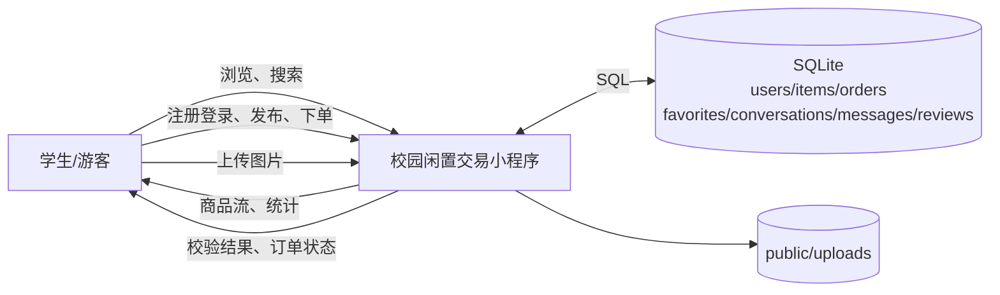

# 需求规格说明书（SRS）

**项目名称**：校园闲置物品交易小程序
**文档版本**：V1.0
**编写日期**：2026-09-29
**状态**：已评审

---

## 1. 引言

### 1.1 编写目的

本文档定义校园闲置物品交易小程序的功能需求与非功能需求，作为概要设计、详细设计、编码与验收测试的唯一依据。预期读者：项目开发人员、测试人员、指导教师及项目验收方。

### 1.2 项目背景

高校学生每学期都会产生大量闲置物品（教材、数码、生活用品、运动装备等），现有渠道存在三类痛点：

1. **信息分散**：QQ 群、朋友圈、贴吧信息刷屏快、难以检索；
2. **信任成本高**：缺乏实名（学号）校验与评价机制，容易踩坑；
3. **交易体验差**：没有订单状态跟踪，爽约、扯皮现象频发。

本项目以「学号注册 + 当面交易 + 订单状态跟踪 + 双向评价」为核心，构建一个轻量、可跑通的校园二手交易小程序。

### 1.3 术语与缩写

| 术语 | 含义 |
| --- | --- |
| 商品状态 | `on_sale` 在售 / `trading` 交易中 / `sold` 已售出 / `offline` 已下架 |
| 订单状态 | `pending` 待确认 / `confirmed` 待交易 / `completed` 已完成 / `cancelled` 已取消 |
| 当面交易 | 买卖双方约定校内公共地点现场验货付款，平台不代收款 |
| 会话 | 买家围绕某件商品与卖家建立的私信通道 |

### 1.4 参考资料

- GB/T 9385—2008《计算机软件需求规格说明规范》
- 本项目 `docs/04-数据库设计.md`、`docs/05-接口文档.md`

---

## 2. 总体描述

### 2.1 产品定位

面向在校学生的**校园级**二手交易 Web 应用，以移动端仿小程序形态呈现（桌面端以手机外壳居中展示，移动端自适应全屏）。

### 2.2 用户角色

| 角色 | 说明 | 关键权限 |
| --- | --- | --- |
| 游客 | 未登录访问者 | 浏览、搜索、查看详情 |
| 买家 | 已登录用户，购买他人商品 | 下单、收藏、私信、确认收货、评价 |
| 卖家 | 已登录用户，发布自有商品 | 发布、编辑、上下架、确认/拒绝接单 |
| 系统 | 后端服务 | 校验、状态机流转、未读统计 |

> 同一账号可同时是买家与卖家，权限按「当前操作的资源归属」动态判定。

### 2.2 用例图（核心）

```mermaid
usecaseDiagram
  actor 学生 as S
  actor 未登录游客 as G
  rectangle 校园闲置交易系统 {
    usecase 注册登录 as UC1
    usecase 浏览检索 as UC2
    usecase 发布闲置 as UC3
    usecase 收藏商品 as UC4
    usecase 下单交易 as UC5
    usecase 确认收货 as UC6
    usecase 评价卖家 as UC7
    usecase 私信沟通 as UC8
    usecase 管理订单 as UC9
  }
  S --> UC1
  G --> UC2
  S --> UC2
  S --> UC3
  S --> UC4
  S --> UC5
  S --> UC6
  S --> UC7
  S --> UC8
  S --> UC9
  UC5 ..> UC1 : «include»
  UC3 ..> UC1 : «include»
  UC7 ..> UC6 : «extend»
```

### 2.3 运行环境

- 服务端：Node.js ≥ 22.13，任意支持 `node:sqlite` 的平台（Windows / macOS / Linux）
- 客户端：Chrome、Edge、Safari、Firefox 等支持 ES2020 的现代浏览器，视口宽度 360–2560px
- 数据存储：SQLite 单文件数据库

---

## 3. 功能需求

> 优先级：**M** = Must（必须）/ **S** = Should（应有）/ **C** = Could（可选）

### 3.1 用户模块（USR）

| 编号 | 需求名称 | 描述 | 优先级 |
| --- | --- | --- | --- |
| USR-01 | 学号注册 | 输入 4–20 位字母数字学号、2–16 位昵称、≥6 位密码、可选学院与手机号；学号全局唯一 | M |
| USR-02 | 学号登录 | 学号 + 密码登录，成功后签发 7 天有效期会话令牌 | M |
| USR-03 | 会话保持 | 令牌保存在客户端，后续请求通过 `Authorization: Bearer` 携带；失效时自动跳转登录 | M |
| USR-04 | 资料维护 | 可修改昵称、学院、手机号、个人简介 | S |
| USR-05 | 修改密码 | 校验原密码后修改新密码，修改成功后强制重新登录 | S |
| USR-06 | 个人中心 | 展示在售/已卖出/已买到/收藏四项统计与各功能入口 | M |
| USR-07 | 退出登录 | 二次确认后清除本地会话 | M |
| USR-08 | 他人主页 | 展示公开资料、评分、TA 的闲置商品列表 | S |

**业务规则**

- BR-USR-01：口令必须以加盐 scrypt 算法存储，任何接口响应不得包含口令散列字段。
- BR-USR-02：注册、登录失败时返回统一文案，不区分「学号不存在」与「密码错误」之外的细节。

### 3.2 商品模块（ITM）

| 编号 | 需求名称 | 描述 | 优先级 |
| --- | --- | --- | --- |
| ITM-01 | 发布商品 | 标题（2–30 字）、分类（8 选 1）、成色（5 选 1）、售价（0.01–99999）、原价、描述（≤500 字）、交易地点、1–6 张图片 | M |
| ITM-02 | 图片上传 | 支持本地文件（PNG/JPG/WebP/GIF，≤4MB）上传与示例图库选择，首图为封面 | M |
| ITM-03 | 编辑商品 | 卖家可修改全部字段并切换上架状态 | M |
| ITM-04 | 下架商品 | 软删除；存在进行中订单时禁止下架 | M |
| ITM-05 | 商品详情 | 图集、价格、成色、卖家信息与评分、浏览量、收藏数、最近评价 | M |
| ITM-06 | 浏览计数 | 每次进入详情浏览量 +1 | C |
| ITM-07 | 草稿 | 发布前可将当前填写内容保存到本机 | C |

**业务规则**

- BR-ITM-01：原价不得低于售价。
- BR-ITM-02：商品发布后初始状态为 `on_sale`。
- BR-ITM-03：仅卖家本人可编辑/下架自己的商品，越权返回 403。
- BR-ITM-04：`offline` 状态商品对非卖家不可见（404）。

### 3.3 检索与分类（SRCH）

| 编号 | 需求名称 | 描述 | 优先级 |
| --- | --- | --- | --- |
| SRCH-01 | 关键词搜索 | 匹配标题或描述，支持热词点击 | M |
| SRCH-02 | 分类筛选 | 按 8 个一级分类精确过滤，返回各类在售数量 | M |
| SRCH-03 | 成色筛选 | 全部 / 全新 / 99新 / 95新 / 9成新 / 8成新 | S |
| SRCH-04 | 价格区间 | 最低/最高价过滤 | S |
| SRCH-05 | 排序 | 综合（时间倒序）、人气、价格升序、价格降序 | M |
| SRCH-06 | 分页 | 默认每页 12 条，上限 30；返回 `total/hasMore`；滚动到底自动加载 | M |
| SRCH-07 | 分类页 | 左侧类目导航 + 右侧商品流，切换类目即时刷新 | M |

### 3.4 收藏模块（FAV）

| 编号 | 需求名称 | 描述 | 优先级 |
| --- | --- | --- | --- |
| FAV-01 | 收藏/取消 | 详情页与列表页均可操作，实时返回收藏总数 | M |
| FAV-02 | 收藏列表 | 分页展示已收藏且未下架的商品 | S |
| FAV-03 | 登录校验 | 未登录点击收藏时引导登录 | M |

### 3.5 交易模块（ORD）

| 编号 | 需求名称 | 描述 | 优先级 |
| --- | --- | --- | --- |
| ORD-01 | 确认下单 | 展示商品、交易地点（默认取商品地点）、留言、金额明细，二次确认后提交 | M |
| ORD-02 | 卖家确认 | 卖家可「确认接单」或「拒绝」 | M |
| ORD-03 | 买家收货 | 仅 `confirmed` 状态可由买家发起完成 | M |
| ORD-04 | 取消订单 | 买卖双方在 `pending`/`confirmed` 状态可取消 | M |
| ORD-05 | 订单列表 | 按「我买到的 / 我卖出的」双角色切换，支持状态筛选与分页 | M |
| ORD-06 | 订单详情 | 状态横幅、三步时间轴、商品与双方信息、单号 | M |
| ORD-07 | 商品状态联动 | 下单→`trading`；完成→`sold`；取消→恢复 `on_sale` | M |

**状态机约束（核心业务规则）**

| 当前状态 | 允许迁移 | 发起方 |
| --- | --- | --- |
| `pending` | `confirmed` | 仅卖家 |
| `pending` | `cancelled` | 买家或卖家 |
| `confirmed` | `completed` | 仅买家 |
| `confirmed` | `cancelled` | 买家或卖家 |
| `completed` / `cancelled` | 终态，不可迁移 | - |

- BR-ORD-01：一个商品同时只允许存在一笔进行中的订单。
- BR-ORD-02：买家不能购买自己发布的商品。
- BR-ORD-03：同一买家对同一商品不允许重复下单（进行中）。

### 3.6 评价模块（REV）

| 编号 | 需求名称 | 描述 | 优先级 |
| --- | --- | --- | --- |
| REV-01 | 买家评价 | 仅订单完成后、仅买家可评，1–5 星 + ≤120 字内容 | M |
| REV-02 | 一次性 | 每笔订单仅可评价一次 | M |
| REV-03 | 评分展示 | 商品详情页展示卖家最近 5 条评价与平均分 | S |

### 3.7 消息模块（MSG）

| 编号 | 需求名称 | 描述 | 优先级 |
| --- | --- | --- | --- |
| MSG-01 | 发起会话 | 买家在商品详情点击「联系卖家」，按（商品 + 买家）幂等创建会话 | M |
| MSG-02 | 会话列表 | 展示对方、商品缩略、最后一条消息、时间、未读数 | M |
| MSG-03 | 聊天 | 气泡式对话，发送即时上屏，按 5 分钟间隔插入时间分隔符 | M |
| MSG-04 | 未读徽标 | 标签栏实时展示未读总数 | M |
| MSG-05 | 增量轮询 | 会话页每 4 秒按 `afterId` 拉取新消息（无 WebSocket 依赖） | S |
| MSG-06 | 已读回执 | 进入会话即标记对方消息已读，未读清零 | M |
| MSG-07 | 越权防护 | 非会话参与方读写均返回 403 | M |

---

## 4. 非功能需求（NFR）

### 4.1 性能

| 编号 | 指标 | 目标值 |
| --- | --- | --- |
| NFR-P-01 | 列表接口响应（1000 条数据量级） | ≤ 200 ms |
| NFR-P-02 | 首屏可交互时间（本机） | ≤ 1.5 s |
| NFR-P-03 | 分页大小上限 | 30 条/页，防止大结果集 |

### 4.2 安全

| 编号 | 要求 | 实现措施 |
| --- | --- | --- |
| NFR-S-01 | 口令不可逆存储 | `scrypt(password, salt16B, 64B)` + `timingSafeEqual` |
| NFR-S-02 | 会话不可伪造 | HMAC-SHA256 签名载荷，密钥随机生成并落盘 |
| NFR-S-03 | 越权访问防护 | 所有写操作校验资源归属，越权返回 403 |
| NFR-S-04 | 目录穿越防护 | 静态资源路径解析后必须位于 `public` 之下 |
| NFR-S-05 | 上传安全 | MIME 白名单（png/jpeg/webp/gif）、4MB 上限、随机文件名 |
| NFR-S-06 | XSS | 前端所有动态文本经 HTML 转义后输出 |
| NFR-S-07 | 注入防护 | 全部 SQL 使用预编译参数绑定 |

### 4.3 可靠性与可维护性

- 所有写操作在单事务语句内完成，异常统一由路由层捕获并返回结构化错误；
- 数据库单文件 + WAL 模式，可直接拷贝备份；
- 静态资源 `Cache-Control: no-store`，避免开发期缓存脏数据；
- 测试库路径可注入，测试与演示数据完全隔离。

### 4.4 易用性

- 移动端仿小程序交互：状态栏、胶囊按钮、底部 5 项标签栏、返回按钮；
- 关键操作（下单、收货、下架、退出）均有二次确认；
- 空状态、加载骨架屏、Toast 反馈覆盖全部异步流程；
- 桌面端展示演示账号与功能清单，便于评审演示。

---

## 5. 数据流图（顶层）



---

## 6. 验收标准

1. `npm test` 全部通过（17 个集成用例）；
2. 演示账号可完成：注册 → 发布 → 搜索 → 收藏 → 下单 → 卖家确认 → 买家收货 → 评价 全链路；
3. 买家与卖家双方可通过私信沟通，未读徽标与已读回执正确；
4. 越权访问（改他人商品、看他人订单、读他人会话）均被拒绝；
5. 文档与实现一致，接口文档可独立驱动联调。
