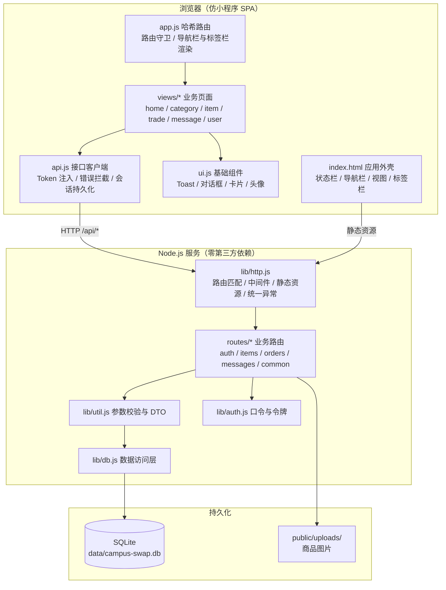
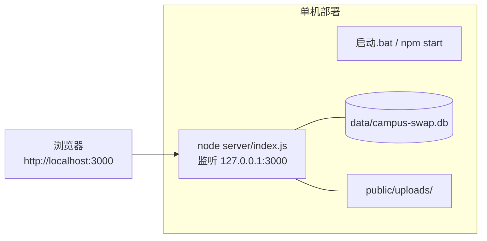

# 概要设计说明书（HLD）

**项目名称**：校园闲置物品交易小程序
**文档版本**：V1.0
**编写日期**：2026-09-29

---

## 1. 设计目标与约束

| 目标 | 说明 |
| --- | --- |
| 零依赖可运行 | 不执行 `npm install` 即可启动，规避供应链与离线环境问题 |
| 分层解耦 | 路由 / 业务校验 / 数据访问单向依赖，前端路由 / 页面 / 组件 / 接口分层 |
| 可测试 | 服务可在临时端口启动，数据库路径可注入 |
| 可演示 | 桌面端以手机外壳呈现，一键启动，内置演示数据 |

**约束**

- 运行时仅使用 Node 内置模块（`node:http`、`node:sqlite`、`node:crypto`、`node:test`）；
- 前端不引入框架与打包器，使用原生 ES2020 + 哈希路由；
- 单机部署，不做分布式与集群。

---

## 2. 总体架构



### 2.1 请求生命周期

```
浏览器
  └─ fetch(/api/items?...)  + Authorization: Bearer <token>
       └─ http.js  App.handle()
            ├─ ① parseBody     解析 JSON 请求体（上限 8MB）
            ├─ ② attachUser    验签并装载 ctx.state.user（不强制登录）
            ├─ ③ 路由匹配      正则 + 路径参数
            │     └─ 路由处理器（可叠加 requireAuth 等守卫）
            │          ├─ util 校验参数
            │          ├─ db 执行预编译 SQL
            │          └─ ctx.json(status, dto)
            └─ ④ 异常兜底      HttpError→业务码 / 其他→500
```

---

## 3. 模块划分

### 3.1 后端模块

| 模块 | 文件 | 职责 | 对外提供 |
| --- | --- | --- | --- |
| Web 框架 | `server/lib/http.js` | 路由编译与分发、中间件链、静态资源、异常处理 | `App`、`HttpError`、`parseBody` |
| 数据访问 | `server/lib/db.js` | 连接管理、建表、`all/get/run` 原子操作、参数归一化 | `all` `get` `run` `now` `close` |
| 认证安全 | `server/lib/auth.js` | scrypt 口令、HMAC 令牌、`attachUser`、`requireAuth` | 见文件导出 |
| 通用工具 | `server/lib/util.js` | 字符串/数值/枚举校验、分页、DTO 组装、枚举常量 | `str` `num` `pickOne` `page` `toItemDTO`… |
| 认证路由 | `server/routes/auth.js` | 注册、登录、资料、密码、统计、用户主页 | 7 个接口 |
| 商品路由 | `server/routes/items.js` | 分类、列表检索、详情、增改删、收藏 | 9 个接口 |
| 交易路由 | `server/routes/orders.js` | 下单、列表、详情、状态流转、评价 | 6 个接口 |
| 消息路由 | `server/routes/messages.js` | 会话、历史、发送、已读 | 5 个接口 |
| 通用路由 | `server/routes/common.js` | 健康检查、未读数、图片上传 | 3 个接口 |
| 装配入口 | `server/index.js` | 组装中间件与路由，`listen` | `app` |
| 数据初始化 | `server/seed.js` | 演示数据（幂等 / `--reset`） | CLI |

### 3.2 前端模块

| 模块 | 文件 | 职责 |
| --- | --- | --- |
| 应用外壳 | `public/index.html` | 手机外壳、状态栏、导航栏、视图容器、标签栏、挂载脚本 |
| 路由器 | `public/js/app.js` | 哈希解析、登录守卫、导航栏/标签栏绘制、滚动代理、未读徽标 |
| 接口层 | `public/js/api.js` | 请求封装、Token 注入、401 拦截、会话持久化 |
| 组件层 | `public/js/ui.js` | 转义、金额、头像、时间、Toast、Confirm、Sheet、Dialog、卡片 |
| 页面层 | `public/js/views/*.js` | 各业务页面的渲染与交互 |

**页面路由表**

| 哈希路由 | 页面 | 标签栏 | 登录守卫 |
| --- | --- | --- | --- |
| `#/home` | 首页（搜索/轮播/分类/推荐流） | ✅ | - |
| `#/category?c=` | 分类页 | ✅ | - |
| `#/publish` `#/publish?id=` | 发布/编辑 | ✅ | ✅ |
| `#/messages` | 会话列表 | ✅ | ✅ |
| `#/profile` | 个人中心 | ✅ | 展示登录引导 |
| `#/search?kw=` | 搜索 | - | - |
| `#/item/:id` | 商品详情 | - | - |
| `#/buy/:id` | 确认下单 | - | ✅ |
| `#/orders?role=` | 订单列表 | - | ✅ |
| `#/order/:id` | 订单详情 | - | ✅ |
| `#/favorites` | 收藏夹 | - | ✅ |
| `#/chat/:id` | 聊天 | - | ✅ |
| `#/user/:id` | 他人主页 | - | - |
| `#/login` | 登录/注册 | - | - |
| `#/settings` | 账号设置 | - | ✅ |

---

## 4. 技术选型与对比

| 关注点 | 选定方案 | 备选方案 | 选择理由 |
| --- | --- | --- | --- |
| 后端框架 | 自研 `lib/http.js`（约 200 行） | Express / Koa | 环境无法 `npm install`；自研层覆盖路由/中间件/静态资源即可，代码可控且便于讲解 |
| 数据库 | SQLite（`node:sqlite`） | MySQL / JSON 文件 | 单文件零部署、支持真 SQL 与索引、便于随项目拷贝；JSON 文件无法支撑多表关联与并发读写 |
| 会话 | HMAC 无状态 Token | Session + Cookie | 无服务端会话存储，天然支持后续多实例扩展；签名验证逻辑透明可测 |
| 口令 | scrypt | bcrypt / MD5 | Node 内置、抗 GPU 暴力破解；MD5 已不安全 |
| 前端框架 | 原生 JS + 哈希路由 | Vue / React | 需要构建链；原生实现即可满足本项目复杂度，且评审时可直接阅读源码 |
| 通信 | 轮询（4s） | WebSocket | 校园规模下轮询实现简单、无连接管理成本；接口已按 `afterId` 增量设计，后续可平滑升级 |
| 图片上传 | JSON + base64 | multipart/form-data | 避免引入 multipart 解析器；4MB 限制下开销可接受 |

---

## 5. 部署方案



**部署步骤**

1. 安装 Node.js ≥ 22.13；
2. 解压项目目录；
3. `node server/seed.js` 初始化演示数据（可选）；
4. `npm start` 或双击 `启动.bat`；
5. 浏览器访问 `http://localhost:3000`。

**生产化建议**（超出本次实现范围）

- 使用 `pm2` / Windows 服务托管进程，配置 `PORT`、`DB_FILE`；
- 反向代理（Nginx）终结 HTTPS，静态资源改回长缓存 + 内容哈希；
- 增加限流、审计日志与数据库定期备份。

---

## 6. 接口分层约定

| 层 | 约定 |
| --- | --- |
| URL | 统一前缀 `/api`，资源名词复数：`/api/items`、`/api/orders` |
| 方法 | GET 查询 / POST 创建或动作 / PUT 更新 / DELETE 删除 |
| 响应 | 一律 JSON：`{ code, message?, ...data }`，HTTP 状态码与 `code` 一致 |
| 鉴权 | `Authorization: Bearer <token>` |
| 分页 | 入参 `page`/`pageSize`，出参 `list/total/page/pageSize/hasMore` |
| 错误 | 400 参数错误 / 401 未登录 / 403 越权 / 404 不存在 / 409 冲突 / 413 过大 / 500 服务器 |

详细字段见 `docs/05-接口文档.md`。

---

## 7. 关键设计决策记录（ADR）

| # | 决策 | 备选 | 结论与影响 |
| --- | --- | --- | --- |
| ADR-1 | 商品下架采用软删除（`status=offline`） | 物理删除 | 保留历史订单引用与统计口径；下架前强制处理进行中订单 |
| ADR-2 | 订单与商品状态双表联动 | 仅订单有状态 | 列表页可直接按商品状态过滤，避免每次联表；代价是需在两处维护，故集中于 `orders` 路由的状态机函数 |
| ADR-3 | 会话按「商品 + 买家」唯一 | 按「用户对」唯一 | 同一买家询问不同商品互不干扰，便于围绕商品议价 |
| ADR-4 | 图片走 base64 JSON | multipart | 免依赖，代价是体积膨胀约 33%，以 4MB 上传上限约束 |
| ADR-5 | 前端哈希路由 | History 路由 | 静态托管无需服务端回退规则，刷新不 404 |
