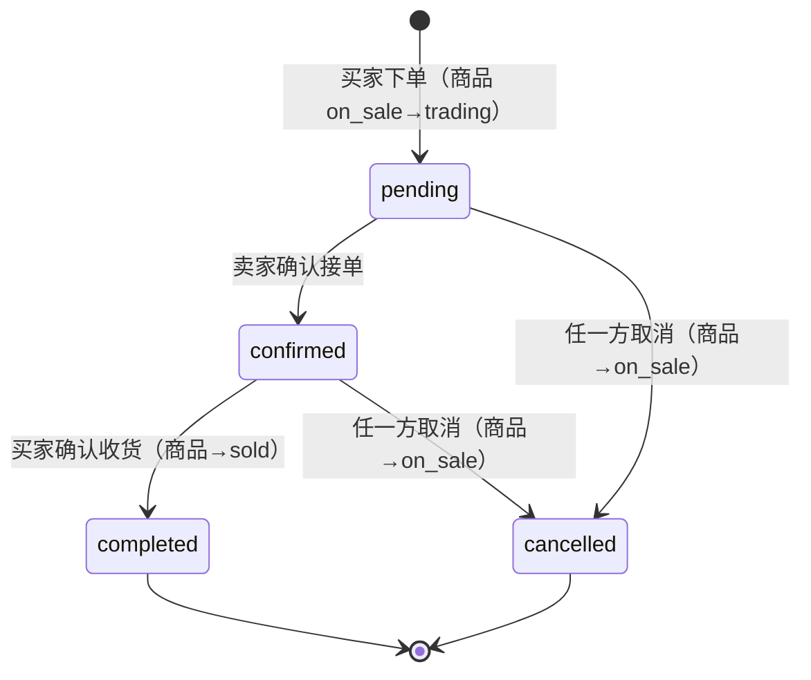

# 详细设计说明书（LLD）
**项目名称**：校园闲置物品交易小程序
**文档版本**：V1.0
**编写日期**：2026-09-29

---

## 1. 模块清单与依赖

| 模块 | 文件 | 职责 | 依赖 |
| --- | --- | --- | --- |
| HTTP 内核 | `server/lib/http.js` | 路由注册/匹配、中间件链、JSON 解析、静态资源、统一异常 | `node:http` |
| 数据访问 | `server/lib/db.js` | SQLite 连接、建表、`all/get/run`、参数归一化、时间与金额工具 | `node:sqlite` |
| 认证安全 | `server/lib/auth.js` | scrypt 口令散列、HMAC Token 签发/校验、`attachUser`/`requireAuth` | db、crypto |
| 通用工具 | `server/lib/util.js` | 参数校验器、分页、DTO 转换、枚举常量 | http、db |
| 认证路由 | `server/routes/auth.js` | 注册/登录/资料/统计/用户主页 | 以上全部 |
| 商品路由 | `server/routes/items.js` | 分类/检索/详情/发布/修改/下架/收藏 | 以上全部 |
| 订单路由 | `server/routes/orders.js` | 下单/状态机/评价 | 以上全部 |
| 消息路由 | `server/routes/messages.js` | 会话/收发消息/已读 | 以上全部 |
| 通用路由 | `server/routes/common.js` | 健康检查/未读数/图片上传 | 以上全部 |
| 服务入口 | `server/index.js` | 组装中间件与路由、静态服务、监听端口 | 以上全部 |
| 演示数据 | `server/seed.js` | 幂等初始化演示账号/商品/订单/会话 | 以上全部 |
| 前端外壳 | `public/index.html`、`public/js/app.js` | 状态栏/导航栏/标签栏、哈希路由与守卫 | ui、views |
| 前端服务 | `public/js/api.js` | fetch 封装、Token 注入、错误拦截 | — |
| 前端页面 | `public/js/views/*.js` | 六个业务页面的渲染与交互 | api、ui |

依赖方向单向：`routes → lib`，`views → api/ui`，不允许反向引用。

---

## 2. HTTP 内核设计（`server/lib/http.js`）

### 2.1 路由注册与匹配

```js
app.get('/api/items/:id', handler)   // 注册
app.post('/api/orders', handler)
app.del('/api/items/:id', handler)   // DELETE
```

- 注册时将 pattern 规范化为 `'/' + pattern`（修复历史缺陷：漏前导斜杠导致全 404）；
- 将 pattern 按 `/` 切段，与请求路径段逐一比对：
  - 常量段：全等匹配；
  - `:name` 段：捕获写入 `ctx.params`（自动 `Number` 化可转数字的捕获值）；
  - 段数不同即不匹配；
- 请求路径统一去尾斜杠（`/api/items/` ≡ `/api/items`），根路径 `/` 除外；
- 方法不匹配返回 405，路径无匹配返回 404，二者均走统一错误响应。

### 2.2 中间件链

顺序固定为：

1. `requestId`：为每个请求生成序号，便于日志追踪；
2. `bodyParser`：仅解析 `application/json`，上限 6MB，非法 JSON 抛 400；
3. `attachUser`（auth.js）：解析 `Authorization: Bearer` 或 `?token=`，成功则装载 `ctx.state.user`（不强制）；
4. `cors`：开发期允许跨域，带 `OPTIONS` 预检；
5. 路由处理器；
6. 统一 `try/catch`：`HttpError` 按其 status/message 输出，未知错误输出 500 且不泄露堆栈。

### 2.3 统一响应格式

```jsonc
// 成功
{ "code": 200, "message": "可选说明", "...": "业务字段" }
// 失败
{ "code": 400, "message": "面向用户的中文提示" }
```

### 2.4 静态资源服务

- 根目录 `public/`，路径穿越（`..`）强制拦截；
- 响应头 `Cache-Control: no-store`（避免演示时缓存旧 JS）；
- MIME 由扩展名表映射，默认 `application/octet-stream`；未命中扩展返回 `index.html`（SPA 兜底由哈希路由处理，实际仅 `/` 需要）。

---

## 3. 认证与安全设计（`server/lib/auth.js`）

### 3.1 口令存储

```
存储格式：`{salt16hex}$${scryptSync(password, salt, 64)hex}`
校验：拆出 salt → 重算 → 长度比较 + crypto.timingSafeEqual（防时序侧信道）
```

- 每用户随机 16 字节盐，无彩虹表风险；
- 数据库仅存 `password_hash`，任何接口通过 `publicUser()` 输出，**永不返回散列**（测试用例 TC-04 断言）。

### 3.2 会话 Token（无状态 HMAC）

```
payload = base64url({ u: userId, e: expireAt })   // TTL = 7 天
token   = payload + "." + HMAC-SHA256(payload, SECRET)
```

- `SECRET` 首次运行随机生成，存 `data/secret.key`（权限 0600）；
- 校验：签名恒定时间比较 → 解析 payload → 检查过期；
- 伪造/篡改/过期 token 一律解析失败，等同未登录（401）。

### 3.3 权限控制点

| 控制点 | 实现 |
| --- | --- |
| 必须登录 | `requireAuth(ctx)` 抛 401 |
| 资源属主 | `requireOwner(item, me)` 比对 `seller_id`，不匹配抛 403 |
| 订单参与方 | 仅 `buyer_id` / `seller_id` 可查看与操作，否则 403 |
| 会话参与方 | `loadConv` 校验 `buyer_id/seller_id`，否则 403 |
| 状态机角色 | `TRANSITIONS[next]` 白名单限定买家/卖家 |

### 3.4 输入校验

`lib/util.js` 提供三个声明式校验器，路由层组合使用：

- `str(body, key, {label,min,max,required,def})`：空值、长度；
- `num(body, key, {label,min,max,integer})`：`Number.isFinite`、范围、整数；
- `pickOne(body, key, list)`：枚举白名单（分类、成色、状态）。

所有校验失败抛 400 + 中文提示，**SQL 一律使用参数绑定**，杜绝注入。

---

## 4. 商品模块详细设计

### 4.1 列表检索（`GET /api/items`）条件拼装

```
scope  := mine=1 → 我的（需登录，可选 status）
        | sellerId → 某卖家在售+已售
        | 默认 → status='on_sale'
filter := keyword(标题/描述 LIKE) + category + condition + [minPrice,maxPrice]
order  := new(默认) | price_asc | price_desc | hot
分页   := page/pageSize（上限 30），返回 total 与 hasMore
```

条件全部以命名参数动态追加，未提供的参数不出现在 SQL 中（与 `db.normalize` 的"剔除未引用键"机制配套）。

### 4.2 详情的三个附带查询

1. 卖家近 5 条评价（社交证明）；
2. 当前用户对该商品的进行中订单 `activeOrder`（用于详情页按钮态切换）；
3. 浏览量 `view_count + 1`（读取后自增，DTO 同步 +1 使前端即时可见）。

下架商品对非卖家返回 404（软删除对外不可见）。

### 4.3 图片校验（`validateImages`）

- 上限 6 张，单张序列化长度 ≤ 500KB；
- 地址白名单：`/uploads/`、`/img/`、`data:image/`、`http(s)://`；
  `javascript:` 等危险协议被拒绝（测试用例 TC-14 覆盖）；
- 以 JSON 文本存入 `items.images` 列。

### 4.4 上传流程（`POST /api/upload`）

```
前端 FileReader → dataURL(base64)
  → 正则解析 MIME 白名单（png/jpeg/webp/gif）
  → base64 解码，4MB 上限（413）
  → 文件名 = 时间戳_6字节随机hex + 扩展名（防覆盖、防猜测）
  → 写 public/uploads/，返回 /uploads/xxx
```

选用 JSON+base64 而非 multipart，是为了不引入第三方解析依赖。

---

## 5. 订单状态机（核心）

### 5.1 状态与允许迁移

| 当前状态 | 可迁移到 | 操作角色 | 商品联动 |
| --- | --- | --- | --- |
| `pending` 待卖家确认 | `confirmed` | 仅卖家 | — |
| `pending` | `cancelled` | 买家或卖家 | 商品 → `on_sale` |
| `confirmed` 待当面交易 | `completed` | 仅买家 | 商品 → `sold` |
| `confirmed` | `cancelled` | 买家或卖家 | 商品 → `on_sale` |
| `completed` / `cancelled` | （终态） | — | — |



### 5.2 校验次序（`POST /api/orders/:id/status`）

```
1. 目标状态在 TRANSITIONS 白名单？        否 → 400
2. 订单存在？                            否 → 404
3. 操作者是买家或卖家？                   否 → 403
4. 操作角色在该目标状态允许列表中？         否 → 403（"该操作只能由买家发起"）
5. 当前状态 → 目标状态在合法迁移表中？      否 → 400（状态不可变更）
6. 写入新状态 + updated_at，并执行商品状态联动
```

### 5.3 下单的并发与约束

- 商品必须 `on_sale`，否则 400（已被他人下单/已售）；
- 同一买家对同一商品已有 `pending/confirmed` 订单 → 400（防重复）；
- 不能购买自己发布的商品 → 400；
- 下单成功后商品立即置 `trading`，使后续下单在第 2 步被拦截——以商品状态作为"锁"，避免超卖。

---

## 6. 消息模块详细设计

### 6.1 会话幂等

`conversations` 上有 `UNIQUE(item_id, buyer_id)`：买家对同一商品反复"联系卖家"命中既有会话而非新建；卖家对自己商品发起咨询 → 400。

### 6.2 读模型

- `convBrief()` 统一生成会话摘要：对方用户、商品缩略、最后一条消息、**未读数**（`sender_id != me AND is_read = 0`）、角色；
- 会话列表按 `last_time DESC` 排序，随发随更（发送消息时同步 `last_message/last_time`）；
- 已读回执一次性把"对方发来的"消息置 `is_read=1`；
- `/api/unread` 聚合全部会话未读总数，供标签栏徽标轮询。

### 6.3 历史拉取

- 默认：取最近 `limit` 条 `ORDER BY id DESC` 后反转为正序返回；
- 增量：`afterId` 之后 `ORDER BY id ASC`（轻量轮询用，避免重复拉全量）。

---

## 7. 前端详细设计

### 7.1 哈希路由

```
#/home 首页    #/category 分类    #/item/:id 详情
#/trade/:tab 交易（发布/我买到的/我卖出的）
#/message(/:convId) 消息    #/user(/:id) 我的/他人主页
#/login #/register 登录注册
```

守卫规则：需登录的路由（`trade`、`message`、发布动作）在未登录时重定向 `#/login?back=原路由`；`api.js` 收到 401 自动清理本地会话并跳登录。

### 7.2 视图渲染约定

每个 view 模块导出 `{ title, render(params) }`，`app.js` 负责：

1. 解析 hash → 找到 view；
2. 渲染导航栏（返回键/标题/操作位）与标签栏（消息未读徽标）；
3. 调用 `view.render` 填充 `#view` 容器；
4. 滚动位置复位。

DOM 拼接一律通过 `ui.js` 的 `esc()` 转义，防 XSS。

### 7.3 轮询

登录态下每 15s 调 `GET /api/unread` 更新徽标；聊天页打开时每 5s 用 `afterId` 增量拉取。

---

## 8. 关键算法与公式

| 项 | 公式/规则 |
| --- | --- |
| 卖家评分 | `ROUND(AVG(reviews.rating), 1)`，附评价数 `COUNT(*)` |
| 累计成交额 | `SUM(orders.price) WHERE seller_id=me AND status='completed'` |
| 分页偏移 | `offset = (page-1) × pageSize`，`pageSize ∈ [1,30]` |
| 金额精度 | `Math.round(v*100)/100`（round2），入库为 REAL，出库再 round2 |
| 未读数 | `COUNT(messages) WHERE conv 属于我 AND sender≠我 AND is_read=0` |
| 浏览热度 | `view_count`，排序键 `hot` |

---

## 9. 异常与边界处理

| 场景 | 处理 |
| --- | --- |
| 路由 404 / 方法 405 | 统一 JSON 错误体 |
| JSON 解析失败 / 超 6MB | 400 / 413 |
| SQLite 约束冲突 | 外层 catch 转 500；唯一性业务先行检查（重复学号 409） |
| 图片 JSON 解析失败 | `parseImages` 兜底返回 `[]`，页面不崩 |
| 非法分类/页码参数 | 前端兜底回退默认值，服务端 clamp 到合法区间 |
| 删除存在进行中订单的商品 | 400 拦截，要求先处理订单 |
| Node 版本过低无 `node:sqlite` | 启动即打印中文指引并退出 |

---

## 10. 可测试性设计

- `app.listen(0)` 支持随机端口，测试注入 `BASE`；
- `DB_FILE` 环境变量可重定向数据库，测试用 `os.tmpdir()` 独立库；
- `QUIET=1` 抑制横幅，避免污染测试输出；
- `seed.js` 幂等，可重复执行。
