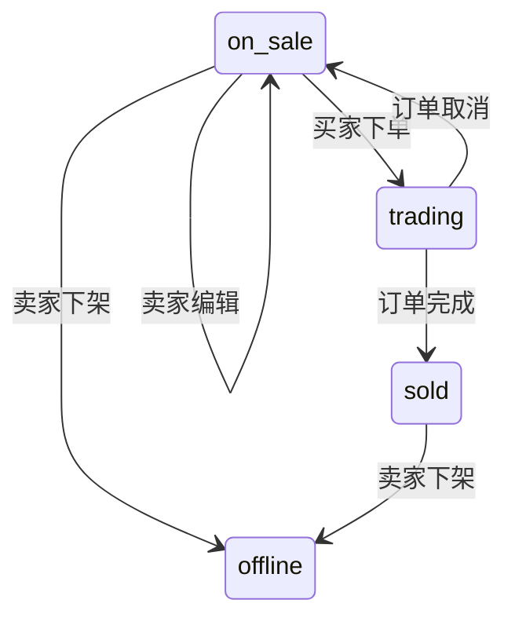

# 数据库设计说明书
**项目名称**：校园闲置物品交易小程序
**文档版本**：V1.0
**编写日期**：2026-09-29
**数据库**：SQLite 3（通过 Node.js 内置 `node:sqlite` 访问），文件 `data/campus-swap.db`

---

## 1. 设计原则

| 原则 | 落地方式 |
| --- | --- |
| 零依赖 | 不引入 ORM，建表 DDL 内嵌于 `server/lib/db.js`，启动时 `CREATE TABLE IF NOT EXISTS` 幂等执行 |
| 软删除 | 商品"下架"为状态字段 `status='offline'`，保留历史订单引用 |
| 可追溯 | 订单冗余保存成交时 `price`，不受商品后续改价影响 |
| 性能 | 为高频查询建立 7 个索引（见 §6） |
| 完整性 | 外键 `ON DELETE CASCADE` + `PRAGMA foreign_keys=ON`；业务层先行校验 |

运行期 PRAGMA：

```sql
PRAGMA journal_mode = WAL;      -- 读写并发
PRAGMA foreign_keys = ON;       -- 启用外键约束
PRAGMA busy_timeout = 3000;     -- 写锁等待
```

---

## 2. 实体关系图（ER）

```mermaid
erDiagram
    USERS ||--o{ ITEMS        : "发布 seller_id"
    USERS ||--o{ FAVORITES    : "收藏 user_id"
    USERS ||--o{ ORDERS       : "购买 buyer_id"
    USERS ||--o{ ORDERS       : "出售 seller_id"
    USERS ||--o{ REVIEWS      : "收到 seller_id"
    USERS ||--o{ REVIEWS      : "发出 buyer_id"
    USERS ||--o{ CONVERSATIONS: "作为买家 buyer_id"
    USERS ||--o{ CONVERSATIONS: "作为卖家 seller_id"
    USERS ||--o{ MESSAGES     : "发送 sender_id"
    ITEMS ||--o{ FAVORITES    : "被收藏 item_id"
    ITEMS ||--o{ ORDERS       : "被下单 item_id"
    ITEMS ||--o{ CONVERSATIONS: "被咨询 item_id"
    ORDERS ||--o| REVIEWS     : "一单一评 order_id"
    CONVERSATIONS ||--o{ MESSAGES : "承载 conv_id"

    USERS {
        int id PK
        text student_id UK "学号 4-20 位字母数字"
        text nickname "昵称"
        text password_hash "salt$scrypt"
        text college "学院"
    }
    ITEMS {
        int id PK
        int seller_id FK
        text title "标题 2-30 字"
        text category "分类枚举"
        real price "售价"
        text status "on_sale/trading/sold/offline"
        text images "JSON 数组"
    }
    ORDERS {
        int id PK
        int item_id FK
        int buyer_id FK
        int seller_id FK
        real price "成交价快照"
        text status "pending/confirmed/completed/cancelled"
    }
    REVIEWS {
        int id PK
        int order_id FK "UNIQUE 一单一评"
        int rating "1-5"
    }
    CONVERSATIONS {
        int id PK
        int item_id FK
        int buyer_id FK
        text last_message "摘要"
        UNIQUE item_id+buyer_id "幂等会话"
    }
    MESSAGES {
        int id PK
        int conv_id FK
        int sender_id
        text content "1-500 字"
        int is_read "0/1"
    }
    FAVORITES {
        int user_id PKFK
        int item_id PKFK
    }
```

---

## 3. 表结构定义

### 3.1 users（用户表）

| 列 | 类型 | 约束 | 说明 |
| --- | --- | --- | --- |
| id | INTEGER | PK AUTOINCREMENT | 用户 ID |
| student_id | TEXT | NOT NULL UNIQUE | 学号，登录凭证，`^[A-Za-z0-9]{4,20}$` |
| nickname | TEXT | NOT NULL | 昵称，2-16 字 |
| password_hash | TEXT | NOT NULL | `salt$scrypt` 格式，**永不出接口** |
| avatar | TEXT | DEFAULT '' | 头像 URL（空则前端渲染首字母色块） |
| college | TEXT | DEFAULT '' | 学院 |
| phone | TEXT | DEFAULT '' | 手机号 |
| bio | TEXT | DEFAULT '' | 个人简介，≤60 字 |
| created_at | TEXT | NOT NULL | `YYYY-MM-DD HH:MM:SS` |

### 3.2 items（商品表）

| 列 | 类型 | 约束 | 说明 |
| --- | --- | --- | --- |
| id | INTEGER | PK AUTOINCREMENT | 商品 ID |
| seller_id | INTEGER | FK→users, ON DELETE CASCADE | 卖家 |
| title | TEXT | NOT NULL | 2-30 字 |
| description | TEXT | DEFAULT '' | ≤500 字 |
| category | TEXT | NOT NULL | 枚举：数码电器/教材书籍/生活用品/服饰鞋包/运动户外/美妆个护/乐器手办/其他 |
| price | REAL | NOT NULL | 售价，0.01-99999 |
| original_price | REAL | 可空 | 原价，须 ≥ price |
| condition | TEXT | DEFAULT '99新' | 枚举：全新/99新/95新/9成新/8成新 |
| images | TEXT | DEFAULT '[]' | JSON 字符串数组，1-6 张 |
| spot | TEXT | DEFAULT '校内当面交易' | 交易地点，≤40 字 |
| status | TEXT | DEFAULT 'on_sale' | `on_sale` 在售 / `trading` 交易中 / `sold` 已售 / `offline` 已下架 |
| view_count | INTEGER | DEFAULT 0 | 浏览量 |
| created_at / updated_at | TEXT | NOT NULL | 时间戳 |

**状态语义**：



> 任意时刻一个商品最多只有一个 `pending/confirmed` 订单——以 `status != 'on_sale'` 拦截后续下单，相当于悲观锁。

### 3.3 favorites（收藏表，多对多关联）

| 列 | 类型 | 约束 |
| --- | --- | --- |
| user_id | INTEGER | PK, FK→users CASCADE |
| item_id | INTEGER | PK, FK→items CASCADE |
| created_at | TEXT | NOT NULL（决定收藏列表倒序） |

联合主键 `(user_id, item_id)` 天然去重；插入用 `INSERT OR IGNORE` 实现"收藏幂等"。

### 3.4 orders（订单表）

| 列 | 类型 | 约束 | 说明 |
| --- | --- | --- | --- |
| id | INTEGER | PK AUTOINCREMENT | 订单号 |
| item_id | INTEGER | FK→items CASCADE | 商品 |
| buyer_id | INTEGER | FK→users | 买家 |
| seller_id | INTEGER | FK→users | 卖家 |
| price | REAL | NOT NULL | **下单时价格快照** |
| spot | TEXT | DEFAULT '' | 交易地点（缺省取商品地点） |
| note | TEXT | DEFAULT '' | 买家留言，≤100 字 |
| status | TEXT | DEFAULT 'pending' | 状态机四态（见详细设计 §5） |
| created_at / updated_at | TEXT | NOT NULL | 时间戳 |

### 3.5 reviews（评价表）

| 列 | 类型 | 约束 | 说明 |
| --- | --- | --- | --- |
| id | INTEGER | PK AUTOINCREMENT | 评价 ID |
| order_id | INTEGER | **UNIQUE**, FK→orders CASCADE | 一单一评（数据库级兜底） |
| buyer_id | INTEGER | NOT NULL | 评价人（买家） |
| seller_id | INTEGER | NOT NULL | 被评人（卖家） |
| rating | INTEGER | NOT NULL | 1-5 整数 |
| content | TEXT | DEFAULT '' | ≤120 字 |
| created_at | TEXT | NOT NULL | 时间戳 |

### 3.6 conversations（会话表）

| 列 | 类型 | 约束 | 说明 |
| --- | --- | --- | --- |
| id | INTEGER | PK AUTOINCREMENT | 会话 ID |
| item_id | INTEGER | FK→items CASCADE | 关联商品（会话因商品而生） |
| buyer_id | INTEGER | FK→users CASCADE | 买家 |
| seller_id | INTEGER | FK→users CASCADE | 卖家 |
| last_message | TEXT | DEFAULT '' | 摘要，发送时截断至 60 字 |
| last_time | TEXT | DEFAULT '' | 最后活跃时间，列表排序键 |
| created_at | TEXT | NOT NULL | 创建时间 |
| — | — | **UNIQUE(item_id, buyer_id)** | 同一买家对同一商品仅一个会话（幂等） |

### 3.7 messages（消息表）

| 列 | 类型 | 约束 | 说明 |
| --- | --- | --- | --- |
| id | INTEGER | PK AUTOINCREMENT | 消息 ID，兼作增量游标 `afterId` |
| conv_id | INTEGER | FK→messages 所属会话 CASCADE | 会话 |
| sender_id | INTEGER | NOT NULL | 发送者 |
| content | TEXT | NOT NULL | 1-500 字 |
| kind | TEXT | DEFAULT 'text' | 预留扩展（text/order/system） |
| is_read | INTEGER | DEFAULT 0 | 0 未读 / 1 已读 |
| created_at | TEXT | NOT NULL | 时间戳 |

---

## 4. 关系与基数总结

| 关系 | 基数 | 实现 |
| --- | --- | --- |
| 用户 → 商品 | 1:N | items.seller_id |
| 用户 → 收藏 | M:N | favorites 联合主键 |
| 商品 → 订单 | 1:1 进行中 / 1:N 历史 | 业务层 `status IN ('pending','confirmed')` 校验 |
| 订单 → 评价 | 1:0..1 | reviews.order_id UNIQUE |
| 商品+买家 → 会话 | 1:1 | conversations UNIQUE(item_id, buyer_id) |
| 会话 → 消息 | 1:N | messages.conv_id |

---

## 5. 关键查询

```sql
-- 1. 商品列表（列表页，带卖家评分与收藏标记）
SELECT i.*, u.nickname, RATING 子查询, fav_count, fav_flag
FROM items i JOIN users u ON u.id = i.seller_id
WHERE i.status='on_sale' [AND 条件...]
ORDER BY i.created_at DESC LIMIT @lim OFFSET @off;

-- 2. 个人统计（我的页 6 项数字，单条 SQL 六个标量子查询）
SELECT (在售数),(已售数),(买到数),(收藏数),(成交额),(待处理单);

-- 3. 订单详情（买家/卖家/商品/评价五表联查）
SELECT o.*, i.*, b.*, s.*, rv.*
FROM orders o JOIN items i ON i.id=o.item_id
JOIN users b ON b.id=o.buyer_id JOIN users s ON s.id=o.seller_id
LEFT JOIN reviews rv ON rv.order_id=o.id WHERE o.id=?;

-- 4. 会话列表（含未读数）
SELECT c.*, i.*, b.nickname, s.nickname FROM conversations c ... 
WHERE c.buyer_id=? OR c.seller_id=? ORDER BY c.last_time DESC;

-- 5. 未读总数（标签栏徽标）
SELECT COUNT(*) FROM messages m JOIN conversations c ON c.id=m.conv_id
WHERE (c.buyer_id=? OR c.seller_id=?) AND m.sender_id != ? AND m.is_read=0;
```

---

## 6. 索引设计

| 索引 | 列 | 服务的查询 |
| --- | --- | --- |
| `idx_items_status_cat` | (status, category) | 列表页"在售+分类"过滤（最高频） |
| `idx_items_seller` | (seller_id) | 个人主页、`mine=1` 我的发布 |
| `idx_items_created` | (created_at DESC) | 默认"最新"排序 |
| `idx_orders_buyer` | (buyer_id, created_at DESC) | 我买到的 |
| `idx_orders_seller` | (seller_id, created_at DESC) | 我卖出的 |
| `idx_orders_item` | (item_id) | 下单防重、商品状态联动 |
| `idx_reviews_seller` | (seller_id) | 卖家评分聚合 |
| `idx_conv_buyer` / `idx_conv_seller` | (buyer_id, last_time DESC) / (seller_id, last_time DESC) | 会话列表排序 |
| `idx_msg_conv` | (conv_id, id) | 历史消息与 afterId 增量拉取 |

---

## 7. 数据字典（枚举域）

| 域 | 取值 | 出处 |
| --- | --- | --- |
| 分类 category | 数码电器 / 教材书籍 / 生活用品 / 服饰鞋包 / 运动户外 / 美妆个护 / 乐器手办 / 其他 | `util.CATEGORIES` |
| 成色 condition | 全新 / 99新 / 95新 / 9成新 / 8成新 | `util.CONDITIONS` |
| 商品状态 | on_sale / trading / sold / offline | items.status |
| 订单状态 | pending（待卖家确认）/ confirmed（待当面交易）/ completed（已完成）/ cancelled（已取消） | orders.status |
| 评分 | 1-5 整数 | reviews.rating |

---

## 8. 容量与演进

- 单机校园场景，SQLite WAL 模式可支撑约 10 万级商品、百万级消息，无需分库分表；
- 图片存文件系统而非 BLOB，数据库仅存 URL；
- 演进路径：① 引入全文索引（FTS5）替换 LIKE 检索；② 消息改 WebSocket 推送替代轮询；③ 按月归档已终态订单与消息。
