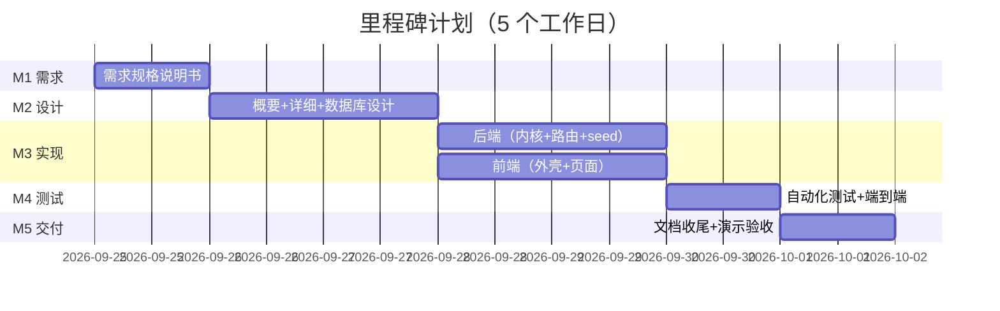

# 项目计划与里程碑
**项目名称**：校园闲置物品交易小程序
**文档版本**：V1.0
**编写日期**：2026-09-29

---

## 1. 项目概述

| 项 | 内容 |
| --- | --- |
| 目标 | 交付一个**符合软件工程规范、可实际运行**的校园二手交易小程序（Web 仿小程序形态），含全套文档与自动化测试 |
| 交付形态 | 单机 Node.js 服务 + 原生 SPA 前端 + SQLite + 全套文档 7 份 |
| 验收口径 | ① 一条命令启动 ② 17/17 自动化测试通过 ③ 浏览器端到端全流程可演示 ④ 文档齐全 |
| 技术约束 | 零第三方依赖（仅 Node 内置模块），免 `npm install` |

---

## 2. WBS（工作分解结构）

```
1 校园闲置物品交易小程序
├─ 1.1 需求分析
│   ├─ 1.1.1 业务流程梳理（注册/浏览/发布/下单/交易/评价/私信）
│   ├─ 1.1.2 功能需求编号（FR/USR/ITM/ORD/MSG）
│   └─ 1.1.3 需求规格说明书（docs/01）
├─ 1.2 设计
│   ├─ 1.2.1 概要设计：总体架构、分层、技术选型（docs/02）
│   ├─ 1.2.2 详细设计：路由内核、状态机、时序（docs/03）
│   └─ 1.2.3 数据库设计：ER、7 张表、索引（docs/04）
├─ 1.3 后端实现
│   ├─ 1.3.1 lib：http / db / auth / util
│   ├─ 1.3.2 routes：auth / items / orders / messages / common
│   ├─ 1.3.3 入口与演示数据 seed
│   └─ 1.3.4 图片上传与占位图生成工具
├─ 1.4 前端实现
│   ├─ 1.4.1 应用外壳与哈希路由
│   ├─ 1.4.2 基础组件 ui / 接口层 api
│   ├─ 1.4.3 六个业务页面 views
│   └─ 1.4.4 手机外壳样式
├─ 1.5 测试
│   ├─ 1.5.1 集成测试用例设计（docs/06）
│   ├─ 1.5.2 自动化实现 tests/api.test.js
│   └─ 1.5.3 浏览器端到端验证
├─ 1.6 交付
│   ├─ 1.6.1 接口文档（docs/05）、项目计划（docs/07）
│   ├─ 1.6.2 README、启动.bat
│   └─ 1.6.3 运行演示与验收
```

---

## 3. 里程碑计划



| 里程碑 | 交付物 | 出口准则（DoD） | 状态 |
| --- | --- | --- | --- |
| M1 需求基线 | `docs/01-需求规格说明书.md` | 功能点全部编号，无二义性 | ✅ 完成 |
| M2 设计基线 | `docs/02/03/04` | 架构图、状态机、ER 图评审通过 | ✅ 完成 |
| M3 实现完成 | 后端 10 文件 + 前端 10 文件 + seed | `node server/index.js` 可启动，接口自测通过 | ✅ 完成 |
| M4 测试通过 | `tests/api.test.js`、`docs/06` | 17/17 通过 + E2E 12 步通过 | ✅ 完成 |
| M5 交付验收 | `docs/05/07`、README、启动.bat | 一键启动 + 全流程演示 | ✅ 完成 |

---

## 4. 任务排期与实际工时

| 阶段 | 任务 | 预估 | 实际 | 产出 |
| --- | --- | --- | --- | --- |
| 需求 | 流程与需求规格 | 0.5d | ✔ | docs/01 |
| 设计 | 概要/详细/数据库设计 | 1d | ✔ | docs/02-04 |
| 后端 | http 内核、auth、db | 0.5d | ✔ | server/lib/* |
| 后端 | 5 组业务路由 + seed | 0.75d | ✔ | server/routes/* |
| 前端 | 外壳、路由、api/ui | 0.5d | ✔ | public/js/* |
| 前端 | 6 页面 + 样式 | 0.75d | ✔ | views、app.css |
| 环境 | 免安装 Node 部署 | 0.1d | ✔ | PATH 注入、启动.bat |
| 测试 | 17 用例 + 缺陷修复 | 0.5d | ✔ | tests/api.test.js |
| 文档 | 05/06/07 + README | 0.4d | ✔ | docs/*、README |
| **合计** | | **≈5d** | | |

**关键路径**：需求 → 设计 → http 内核 → 业务路由 → 前端页面 → 测试 → 交付。
前后端在设计基线后并行（1.3 / 1.4）。

---

## 5. 缺陷与变更记录

| 编号 | 阶段 | 问题 | 根因 | 修复 | 影响 |
| --- | --- | --- | --- | --- | --- |
| B-01 | 后端 | 全部接口 404 | 路由注册漏前导斜杠，正则不匹配 | 注册时统一补 `'/'` + 路径去尾斜杠 | 关键 |
| B-02 | 后端 | 命名参数报"未知参数" | SQL 未引用的键被传入驱动 | `db.normalize` 按 SQL 实际引用过滤 | 高 |
| B-03 | 后端 | `run()` 返回 BigInt 业务层溢出 | `node:sqlite` 返回 BigInt | 统一 `Number()` 归一化 | 中 |
| B-04 | 后端 | 静态资源缓存旧 JS | 默认缓存策略 | `Cache-Control: no-store` | 中 |
| B-05 | 后端 | 指定端口被占时横幅打印错误 | 横幅未用实际分配端口 | 按 `server.address().port` 打印 | 低 |
| B-06 | 前端 | 导航栏/标签栏不渲染 | 对象字面量中引用 `#私有方法` 语法错误 | 改为普通函数 `paintNav/paintTab` | 高 |
| B-07 | 前端 | 弹层被遮挡 | `hidden` 属性被 `display:flex` 覆盖 | 样式层 `[hidden]{display:none!important}` | 中 |
| B-08 | 前端 | 非法分类参数页面崩溃 | 未做兜底 | 分类非法时回退全部 | 中 |
| B-09 | 环境 | 控制台 emoji 编码报错 | PowerShell GBK 编码 | 图片生成改为 Node 脚本 `tools/gen-images.js` | 低 |

变更控制：需求基线后的新增诉求（如示例图库、演示账号）走轻量变更，记录于本表并同步 docs/01。

---

## 6. 风险管理

| 风险 | 概率 | 影响 | 应对 |
| --- | --- | --- | --- |
| 环境无 Node、无法联网安装 | 高 | 阻塞 | 免安装 zip 版 Node + 零依赖设计，见 docs/01 §约束 |
| 系统命令中文编码损坏 | 中 | 中 | 所有生成物经 Node 脚本落盘，避免 PowerShell 直写 UTF-8 |
| 浏览器截图不可用（窗口不可见） | 中 | 低 | 以 DOM 快照/接口断言验证，人工目验兜底 |
| 单账号并发下单超卖 | 低 | 高 | 商品状态锁（trading）+ 进行中订单查重 |
| 演示数据被测试污染 | 中 | 中 | 测试独立临时库；seed 幂等可随时重置 |
| SQLite 写锁冲突 | 低 | 中 | WAL + busy_timeout=3000 |

---

## 7. 团队与职责（单人全栈角色分解）

| 角色 | 职责 | 产出 |
| --- | --- | --- |
| 需求分析师 | 流程建模、需求编号与验收标准 | docs/01 |
| 架构/设计 | 分层、状态机、ER、接口契约 | docs/02-05 |
| 后端开发 | 内核、路由、数据、安全 | server/** |
| 前端开发 | SPA、组件、交互 | public/** |
| 测试工程师 | 用例设计、自动化、E2E | tests/**、docs/06 |
| 项目经理 | 计划、风险、里程碑跟踪 | docs/07 |

---

## 8. 验收清单

- [x] `启动.bat` 或 `npm start` 一条命令启动，横幅打印正确端口
- [x] `npm test` 17/17 通过，且不污染演示库
- [x] 4 个演示账号可登录，12 件预置商品、历史订单与会话可查看
- [x] 注册/登录/浏览/搜索/筛选/收藏/发布/私信/下单/确认/收货/评价 全流程可演示
- [x] 越权与非法输入统一返回规范错误（401/403/404/409/400）
- [x] 文档 7 份齐全且与实现一致（接口 31 个、表 7 张、用例 17 条）
